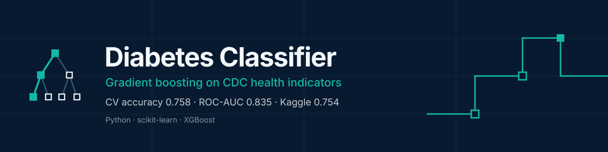
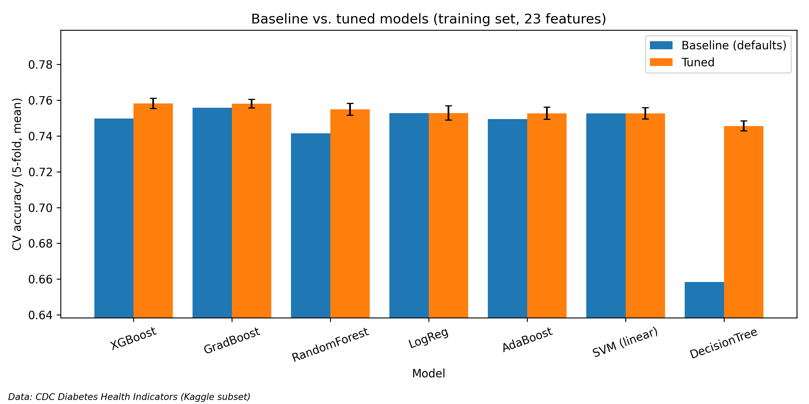
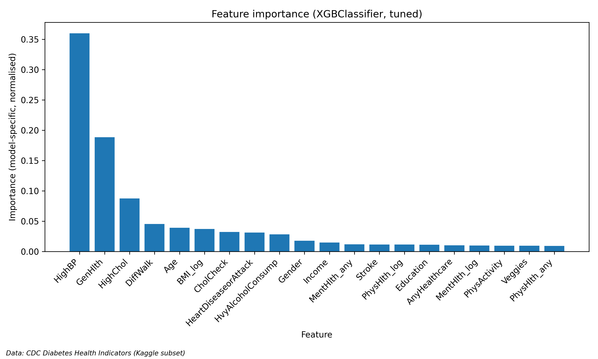
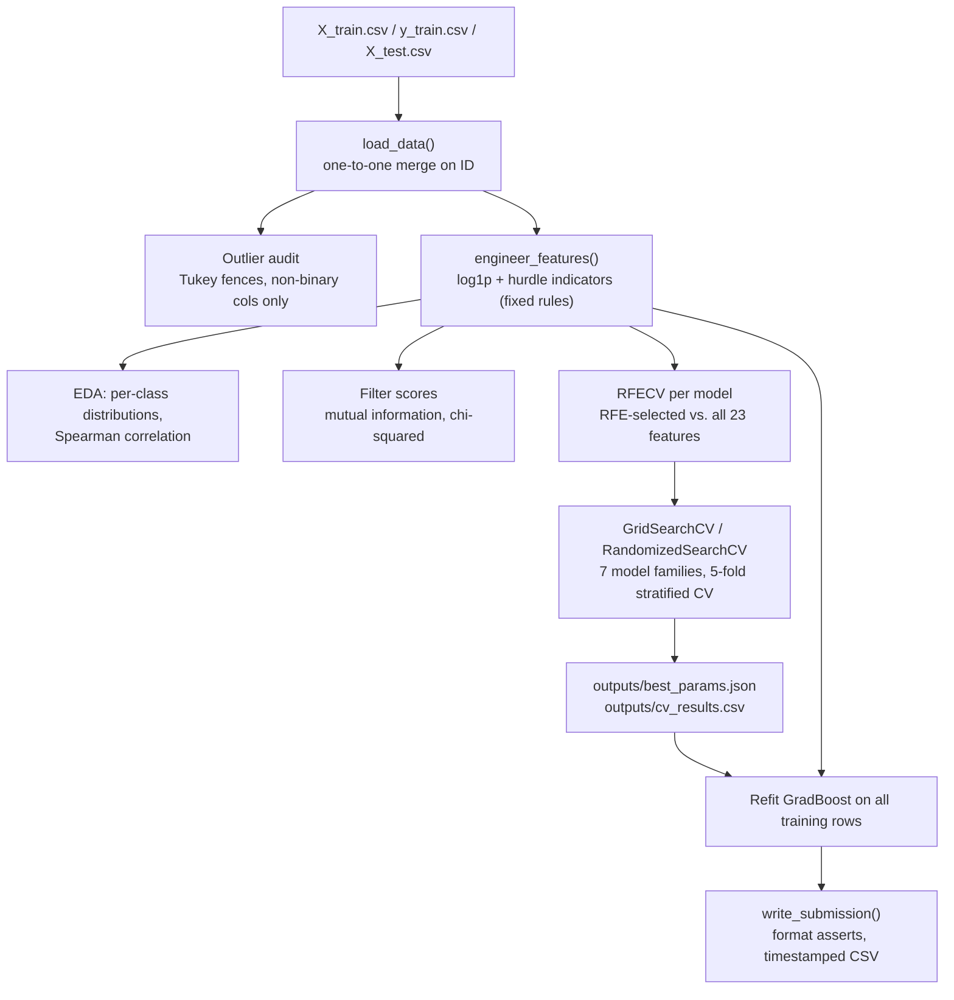

<p align="center">
  
</p>

Binary classification of diabetes diagnosis (Yes / No) from 21 lifestyle, demographic and health indicators in a balanced subset of the CDC Diabetes Health Indicators dataset. The repo compares seven model families (logistic regression, decision tree, random forest, linear SVM, AdaBoost, gradient boosting, XGBoost) under leakage-free 5-fold stratified cross-validation, built for a Kaggle classroom competition.

📖 **[Full methodology, decision log and per-step results → documentation.md](documentation.md)**

## Results at a glance

<p align="center">
  
  
</p>

Tuned gradient boosting and XGBoost tie at **0.758 CV accuracy / 0.835 ROC-AUC**, about +0.005 over the linear models, which plateau at 0.753 with or without tuning. Two differently configured boosters converging on the same score points to a feature-information ceiling rather than a tuning gap. The submitted GradBoost model scored **0.754 on the Kaggle leaderboard**, within about 1.5 standard errors of the CV estimate.

## Architecture



## Results

| Model | Baseline acc | Tuned acc (± fold std) | Tuned ROC-AUC | Tuned F1 |
|---|---|---|---|---|
| XGBoost | 0.750 | **0.758 ± 0.003** | **0.835** | **0.768** |
| Gradient Boosting (submitted) | 0.756 | **0.758 ± 0.002** | **0.835** | **0.768** |
| Random Forest | 0.742 | 0.755 ± 0.003 | 0.832 | 0.765 |
| Logistic Regression | 0.753 | 0.753 ± 0.004 | 0.829 | 0.758 |
| AdaBoost | 0.749 | 0.753 ± 0.003 | 0.831 | 0.758 |
| SVM (linear) | 0.753 | 0.753 ± 0.003 | 0.829 | 0.759 |
| Decision Tree | 0.658 | 0.746 ± 0.003 | 0.821 | 0.753 |

Kaggle leaderboard (GradBoost): **0.75362** accuracy. Best hyperparameters are in `outputs/best_params.json`, and every experiment row is in `outputs/cv_results.csv`.

## Key modelling decisions

- **No outlier removal.** 28.9 % of rows are flagged by IQR fences, but they are valid survey answers and carry signal (78 % diabetes rate for BMI > 45, against 50 % overall).
- **log1p + two-part (hurdle) encoding** for BMI, MentHlth and PhysHlth. The remaining skew comes from a point mass at zero (57–68 % of rows), which no monotone transform can remove, so the zeros get their own `_any` indicator.
- **PCA rejected:** it is extraction, not selection, it ignores the target, and it suits mostly binary data poorly.
- **All 23 features kept.** RFE matched all-features accuracy for 5 of 7 models (Δ ≤ 0.0003), and the two exceptions were untuned, over-flexible trees that tuning fixed.

## Running it

```bash
pip install -r requirements.txt
jupyter notebook main.ipynb   # Run All
```

Run the notebook top to bottom from a clean kernel (about 30 min on 22 cores): the baseline RFE comparison takes about 7 min and hyperparameter tuning about 20 min. The **Submission** section only needs Setup, Data loading and Feature engineering, because it rebuilds GradBoost from `outputs/best_params.json`. A new timestamped file is written to `outputs/submissions/`.

All paths are relative to the project folder and all randomness is seeded (`RANDOM_STATE = 42`).

## Repository layout

| Path | Contents |
|---|---|
| `main.ipynb` | Full pipeline: EDA → feature engineering → selection → baselines → tuning → submission |
| `documentation.md` | Step-by-step decision log with all intermediate results |
| `overview.md` | Competition brief and variable definitions |
| `X_train.csv`, `y_train.csv`, `X_test.csv`, `sample_submission.csv` | Competition data (raw, never modified) |
| `outputs/figures/` | All figures (300 DPI, with source caption) |
| `outputs/cv_results.csv`, `outputs/best_params.json` | Experiment log and tuned hyperparameters |
| `outputs/submissions/` | Submission files (`ID,Diabetes`) |

## Data

A balanced subset (26,510 Yes / 26,509 No in training, 17,673 test rows) of the **CDC Diabetes Health Indicators** dataset, derived from the CDC's Behavioral Risk Factor Surveillance System (BRFSS) survey and provided by the Kaggle competition. Most features are binary or ordinal self-reported survey answers. See `overview.md` for the variable definitions.

## Note on statistical rigour

- All scores are 5-fold stratified CV means ± fold standard deviation on identical folds. Differences smaller than about one fold-std (≈ 0.003) are treated as noise.
- Every fitted preprocessing step (scaling, RFE) runs inside the CV pipeline, so nothing leaks across folds. Feature engineering uses fixed, non-fitted rules only.
- The tuned CV score is slightly optimistic, because hyperparameters are selected on the same folds. The leaderboard result (0.754 vs. 0.758 CV, accuracy standard error ≈ 0.003 at n = 17,673) is consistent with that.
- Feature importances describe **predictive** association within this model. They do not support causal claims about diabetes risk factors.
